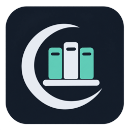

<p align="center"></p>

# AfterShelf

An experimental desktop library for games distributed through F95 and LewdCorner. Browse forum threads, download from a host you choose, track new releases, install full ZIP releases, transfer engine-specific saves/preferences and launch your games.

**Alpha software:** engine profiles use general save-location rules. Report compatibility problems with the platform, engine, app version and redacted text diagnostics from Activity. Real-game update testing is ongoing.

## Downloads and builds

GitHub Actions builds **macOS Apple Silicon (ARM64), macOS Intel (x64), and Windows Intel/AMD (x64)** on every push to `main`, pull request and manual workflow run. Download the architecture-specific packages from [Actions](https://github.com/Auxetics/AfterShelf/actions). Version tags matching `package.json` publish a GitHub prerelease after all three builds succeed.

- macOS: DMG and ZIP application packages.
- Windows: Web Setup plus its separate application payload, and a directly usable ZIP package. Web Setup downloads the payload from the corresponding GitHub release; it does not contain the full runtime. For untagged build artifacts, use the ZIP until the matching release is published.
- These alpha packages are not signed with a publisher certificate or notarized. Automatic application self-updates are not implemented yet.

## Using AfterShelf

1. Choose a games folder, download-only or assisted-install mode, old-version retention and an optional external extraction application.
2. Sign in through the embedded browser, open a game thread and add it to your library. Each game keeps its own F95/LC source; numeric thread IDs are scoped to that source.
3. Choose a hosting provider and start the download yourself. The app does not bypass providers, passwords or login challenges.
4. Keep the archive and reveal it in Finder/Explorer, or install a full ZIP release. The completion popup and library button use the same installation flow: extraction, automatic launcher detection, linked forum metadata, local version comparison, save/preference transfer and registration.
5. Use Play to launch a registered game and Check for updates to discover newer releases.

Ordinary ZIPs use managed extraction. Other formats, passwords and multipart archives use the chosen external extractor; select its output when it cannot report completion. Unknown engines, patches and executable installers require manual installation. Only identified saves/preferences transfer into a new release; old program files are never merged into it. The original release remains until installation completes. Archives are deleted after successful registration, and old-version cleanup follows the chosen retention setting.

The selected games folder is checked on startup. Removed games stay in the library as Not installed, disconnected folders show Files unavailable, and newly discovered recognised games can be added locally without a forum association. Matching archives are hidden from discovery suggestions for already-installed games; they are not deleted. Manual folder scans remain available. Name matching never merges source identities or silently assigns a forum thread.

Failed/cancelled app-managed transfers remove their partial file. Return to thread opens the originating game thread so you can choose a new provider/link yourself. Completed archives and installed games are not removed by clearing download-list records.

Update discovery uses each source's latest listing and a saved checkpoint. A first check establishes that checkpoint from page 1; normal polls verify changed linked games instead of fetching every thread. Missing frontiers or expired listing windows trigger catch-up, and real errors preserve the last successful checkpoint. Source date filters are not assumed to be honoured. An optional full linked-thread check is also available.

## Develop locally

Install Node.js 24 and npm, then:

```sh
npm ci
npm start
```

On macOS, `Start AfterShelf.command` also starts a development checkout after dependencies are installed. No Python or Qt runtime is required.

```sh
npm run check
```

The public checkout contains the application, required assets, dependency lockfile and build configuration. Private tests, internal specifications and local runtime data are excluded from Git.

Build packages locally:

```sh
npm run dist:mac
npm run dist:win
```

The GitHub matrix builds each architecture separately on a matching host and uploads its packages. Publishing a `v<package version>` tag triggers the prerelease job. Publisher signing/notarization is a separate distribution task.

## Privacy and local files

The application keeps its library and Chromium login/session storage in the operating system's application-data directory, outside the source checkout. Existing development profiles are reused. `AFTERSHELF_DATA` can select an isolated development profile; the older `LC_LIBRARY_DATA` override is also recognised. Do not point either override at a tracked source directory.

The repository excludes library databases, cookies/session stores, local credentials, signing keys, diagnostic exports, downloaded games and local test output. Application packages contain the application source/assets, not profiles or tests. Diagnostics can be copied or saved as `.txt`; cookies, credentials, signed query strings and home-directory names are redacted. Nothing is uploaded automatically.

## Known alpha limits

- Save profiles are general engine rules; a game's customised layout or changed save format may need manual handling. Ren'Py and RPG Maker rules have the most fixture coverage.
- HTML games currently launch in the default browser; browser-storage compatibility across changing file locations is not managed by AfterShelf.
- External extraction completion may require output selection. The external app may continue after AfterShelf closes.
- Remove from Library first confirms removal, then offers Keep files or permanent deletion of the current/retained installation folders, including local saves. Downloads and save data outside the deleted installation folders remain. Kept folders are excluded from automatic startup discovery; a manual scan can re-import them.
- Live provider compatibility and complete real-game update/save cycles still need testing. The alpha does not provide game downloads, a torrent client, patch installation or save-format conversion.
